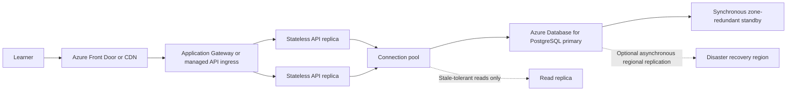

# CloudGenius Database Design

Version 1 of CloudGenius stores questions in JSON files and progress in
`localStorage`. This design is for a future version where learners sign in and
their progress follows them between devices. The SQL is in `schema.sql` and runs
in SQLite.

## Tables

- `topics` stores the three official AZ-900 domains. Each name is unique.
- `concepts` stores the Study Buddy concepts (such as `rbac`). Each belongs to one topic.
- `questions` stores each question's text, explanation and example, and links to its topic and concept.
- `options` stores the four answer choices for each question, their position (0–3), whether each one is correct, and a specific explanation for each incorrect choice.
- `learners` stores each learner's ID, required name and unique email address.
- `attempts` records each completed quiz: who took it, when, and which topic it covered (`NULL` for a mixed quiz).
- `attempt_answers` records which option the learner chose for each question in an attempt.

## Relationships

One topic has many concepts and many questions. One question has four options.
One learner has many attempts, and one attempt has many answers.

`attempt_answers` is a join table. It connects attempts and questions, which have a
many-to-many relationship: one attempt includes many questions, and one question
appears in many learners' attempts. It also stores the option the learner chose
for that attempt–question pair. Its `UNIQUE (attempt_id, question_id)` constraint
stops the same question being saved twice in one attempt.

Correctness is **not** stored in `attempt_answers`. It comes from joining to
`options.is_correct`, so if a question's answer key is ever fixed, every learner's
mastery is recalculated correctly.

## Revision workflow

The current app fetches the question bank from `data/questions.json`. Each item
contains a stable question ID and an `incorrectExplanations` entry for every
wrong option index. Saved attempt answers retain the question ID and selected
index, so the dashboard can fetch the bank and reconstruct the learner's answer,
why it was incorrect, the correct answer, and the general explanation after a
refresh. The SQLite version stores each rationale on its matching `options` row;
an API can return the selected option's rationale alongside the answer key.

The official Microsoft Learn certification page is the source for the AZ-900
exam scope and three domains. Question wording and answer explanations in this
project are original practice content, not copied from Microsoft's assessment.

## Indexes

- `idx_attempts_learner_id` on `attempts(learner_id)` helps SQLite find a learner's attempts quickly for the dashboard.
- `idx_questions_topic_id` on `questions(topic_id)` speeds up loading a single-topic quiz and grouping results by topic.
- The `UNIQUE` constraints on `options(question_id, position)` and `attempt_answers(attempt_id, question_id)` already create useful indexes for those lookups.

## Topic mastery query

The last query in `schema.sql` calculates mastery the same way `computeMastery()`
does in `js/logic.js`: correct answers ÷ attempted questions × 100, grouped by
topic, across all of a learner's attempts.

## SQL or NoSQL

I would choose SQL. Topics, questions, options, learners and attempts have clear
relationships, and the app needs foreign keys, unique emails, exactly one
position per option, and protection against duplicate answers. Calculating
mastery is a natural `JOIN` + `GROUP BY`. A NoSQL database could store attempts as
documents, but the app would then have to enforce these rules itself and work
harder to calculate mastery across many attempts.

## Availability and load balancing

The current app is static: it loads JSON and stores progress in each browser's
`localStorage`. `schema.sql` is a SQLite learning/sample schema, not a running
database. There is no API or database endpoint to load balance today. Do not put
a round-robin load balancer in front of independent writable databases; that
would allow conflicting writes and inconsistent learner records.

For a multi-learner Azure deployment, use this topology:

- Load balance HTTP requests across stateless API replicas. Health probes must
	remove an unhealthy replica from rotation; no learner state should live only
	in an API process.
- Keep one authoritative PostgreSQL primary for writes, with managed
	zone-redundant high availability and automatic failover. A standby is for
	failover, not a second writable node. Use a managed connection pool such as
	PgBouncer to prevent a traffic spike from exhausting database connections.
- Make creating an attempt and all of its answers one database transaction.
	Validate the learner, question, and selected option on the server; derive
	correctness from `options.is_correct`, never from a client-supplied score.
	Preserve foreign keys and the unique `(attempt_id, question_id)` constraint.
- Accept an idempotency key on attempt submission and enforce its uniqueness so
	retrying a timed-out request cannot create duplicate attempts. Retry transient
	database errors with bounded backoff; do not retry non-idempotent writes
	without that key.
- Send writes and read-after-write progress requests to the primary. Use read
	replicas only for queries that can tolerate replication lag, such as older
	analytics or aggregate reports. Never route a learner's just-submitted answer
	to a lagging replica when calculating their immediate result.
- Enable automated backups and point-in-time restore. Optional cross-region
	replication is disaster recovery, not a substitute for backups; asynchronous
	replication can lose recent commits during a regional failover. Set and test
	recovery-point and recovery-time objectives before choosing that configuration.
- Keep question content on the CDN or cache because it changes infrequently.
	Add indexes based on measured API queries, and monitor API health, connection
	pool saturation, database latency, replication lag, and failover events.

These are deployment requirements, not resources created by this repository.
Provisioning a real load balancer or managed database requires an API service,
an Azure subscription, network/security configuration, and an explicit
deployment decision.
